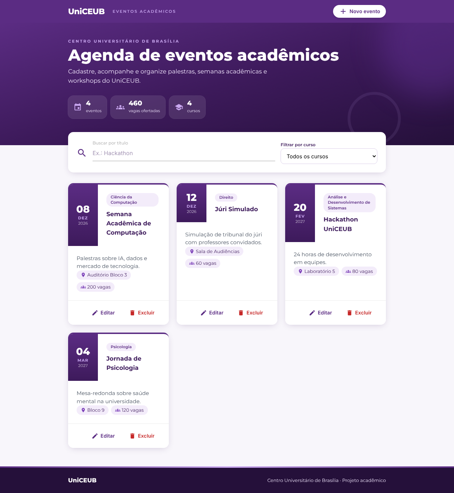

# CEUB Eventos — Gestão de Eventos Acadêmicos


Sistema CRUD para cadastrar, listar, editar e excluir eventos acadêmicos do UniCEUB (palestras, semanas acadêmicas, workshops etc.), implementado com **NestJS, Prisma, Swagger, Segurança OWASP e Autenticação JWT**.



## Requisitos atendidos

| Requisito | Como foi atendido |
|---|---|
| CRUD + Auth | Cadastro/Login JWT e CRUD de eventos (listar com busca/filtro por curso, criar, editar e excluir) |
| Framework Back-end | **NestJS** modular (`AuthModule`, `EventosModule`, `PrismaModule`, `HealthController`) |
| ORMs e Migrations | **Prisma** + SQLite (`prisma/schema.prisma` e migrations em `prisma/migrations/`) |
| Padrão de Tabelas | Convenção `tbl_<num>_<nome>`: `tbl_001_usuarios`, `tbl_002_eventos`, `tbl_003_refresh_tokens` |
| APIs REST & Swagger | OpenAPI em `/api/docs` (`@nestjs/swagger`), métodos HTTP semânticos, status codes, `Location`, cookies e CORS |
| Segurança & OWASP | `helmet` (CSP/HSTS), `bcryptjs`, `AES-256-GCM`, `ValidationPipe` estrito, `@nestjs/throttler`, proteção CSRF (Double Submit Cookie) e JWT |
| Framework Front-end | **React 18 + Vite** + integração JWT (`Authorization: Bearer`, refresh automático e modal de login/cadastro) |
| Tailwind + Materialize | Materialize 1.0 para componentes e Tailwind 3 (`tw-`) para layout e paleta CEUB |
| Testes ≥ 80% | Backend Jest (unit + E2E Supertest) e Frontend Vitest com limiar mínimo de 80% |
| Cypress | **8 testes E2E** cobrindo CRUD completo autenticado com JWT, validação e filtros |

## Estrutura

```text
ceub-eventos/
├── .agents/skills/          # Skills do projeto (arquitetura-backend e seguranca-boas-praticas)
├── .github/workflows/ci.yml # Pipeline CI: backend (NestJS/Prisma) → frontend (Vitest/build) → E2E (Cypress)
├── backend/                 # API NestJS + Prisma + Swagger + JWT
│   ├── prisma/
│   │   ├── schema.prisma    # Models mapeados para tbl_001_usuarios, tbl_002_eventos, tbl_003_refresh_tokens
│   │   └── migrations/
│   ├── src/
│   │   ├── common/          # Criptografia (bcrypt/AES-256-GCM), filtro HTTP, pipes e validadores
│   │   ├── config/          # Validação fail-fast de variáveis de ambiente
│   │   ├── modules/
│   │   │   ├── auth/        # Register, Login, Refresh (CSRF + HttpOnly), Logout, Me (JWT)
│   │   │   ├── eventos/     # CRUD REST com Swagger e controle de acesso (JwtAuthGuard)
│   │   │   └── health/      # GET /api/health
│   │   ├── prisma/          # PrismaService & PrismaModule
│   │   ├── app.module.ts
│   │   └── main.ts          # Helmet, cookie-parser, CORS, ValidationPipe e Swagger (/api/docs)
│   └── test/                # Testes E2E com Supertest
└── frontend/                # React + Vite
    ├── src/
    │   ├── components/      # Header, AuthModal, EventoCard, EventoForm, ConfirmarExclusao
    │   ├── __tests__/       # Vitest + Testing Library
    │   ├── api.js           # Cliente HTTP com Bearer JWT, CSRF e refresh automático
    │   └── App.jsx
    └── cypress/             # Testes E2E com Cypress
```

## Como rodar

### 1. Backend (porta 3000)

```bash
cd backend
cp .env.example .env
npm install
npx prisma migrate dev
npm run start:dev
```

- API disponível em `http://localhost:3000/api`
- Documentação Swagger UI em `http://localhost:3000/api/docs`

### 2. Frontend (porta 5173) — em outro terminal

```bash
cd frontend
npm install
npm run dev
```

Abra `http://localhost:5173`

> Se a API estiver em outro endereço, copie `.env.example` para `.env` e ajuste `VITE_API_URL`.

## Testes e cobertura

```bash
# Backend (unitários + cobertura ≥ 80% + E2E Supertest + build)
cd backend
npm run test:cov
npm run test:e2e
npm run build

# Frontend (Vitest + cobertura ≥ 80% + build)
cd frontend
npm run coverage
npm run build
```

### Testes E2E (Cypress)

Com o **backend rodando** (`npm run start:dev` ou `npm run start:prod`), na pasta `frontend`:

```bash
npm run e2e
```

## Endpoints da API

| Método | Rota | Autenticação | Descrição |
|---|---|---|---|
| POST | `/api/auth/register` | Pública | Cadastra usuário (`tbl_001_usuarios`), gera JWT + cookies `HttpOnly`/CSRF |
| POST | `/api/auth/login` | Pública | Autentica usuário e emite Access Token JWT + cookies |
| POST | `/api/auth/refresh` | Cookie + `x-csrf-token` | Rotaciona Refresh Token e renova Access Token |
| POST | `/api/auth/logout` | Cookie + `x-csrf-token` | Revoga Refresh Token e limpa cookies |
| GET | `/api/auth/me` | Bearer JWT | Retorna perfil do usuário autenticado |
| GET | `/api/eventos?busca=&curso=` | Pública | Lista eventos (`tbl_002_eventos`) ordenados por data |
| GET | `/api/eventos/:id` | Pública | Detalha um evento |
| POST | `/api/eventos` | Bearer JWT | Cria evento (`201 Created` + header `Location`) |
| PUT / PATCH | `/api/eventos/:id` | Bearer JWT | Atualiza evento (com checagem de ownership) |
| DELETE | `/api/eventos/:id` | Bearer JWT | Remove evento (`204 No Content`) |
| GET | `/api/health` | Pública | Status da API |
| GET | `/api/docs` | Pública | Interface interativa Swagger / OpenAPI |
